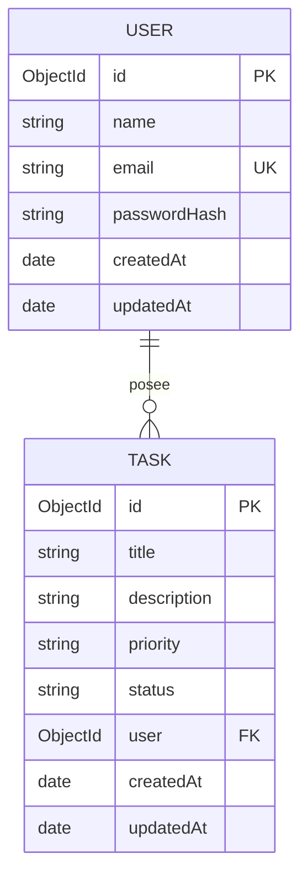

# Arquitectura y decisiones de TaskFlow

## Flujo de una petición protegida

1. React toma el JWT de la sesión de la pestaña y envía `Authorization: Bearer <token>`.
2. Express aplica cabeceras de seguridad, CORS, límite de cuerpo y las rutas.
3. El middleware JWT verifica firma y expiración y resuelve el usuario.
4. La validación rechaza tipos, campos no permitidos y valores fuera del contrato.
5. El controlador consulta Mongoose utilizando simultáneamente el identificador de tarea y el del usuario autenticado.
6. MongoDB devuelve o modifica únicamente el documento que coincide con ese filtro.
7. La API serializa campos públicos; el middleware central traduce errores a JSON.
8. React actualiza su estado con la respuesta real y presenta mensajes de éxito o error.

## Separación de responsabilidades

| Módulo | Responsabilidad |
| --- | --- |
| `client/src/pages` | Pantallas de registro, login y dashboard |
| `client/src/components` | Formularios, tarjetas, navegación, modales y mensajes reutilizables |
| `client/src/context` y `hooks` | Sesión y lógica compartida de React |
| `client/src/services` | Cliente Fetch y contrato HTTP |
| `client/src/types` | Tipos de usuario, tarea, autenticación y error |
| `server/src/config` | Entorno validado y conexión de MongoDB |
| `server/src/models` | Esquemas, validaciones, índices y serialización pública |
| `server/src/controllers` | Operaciones de autenticación y tareas |
| `server/src/routes` | Métodos y rutas REST |
| `server/src/middlewares` | Autenticación, validación y errores |
| `scripts` | Configuración local y lanzador de base persistente |

## Datos

El campo almacenado `User.password` contiene un hash; `passwordHash` en el diagrama describe su significado. El correo es único y se normaliza. La tarea guarda una referencia ObjectId a su usuario. El índice por propietario favorece la lista personal. `createdAt` y `updatedAt` son automáticos.

Mongoose valida documentos antes de guardarlos y el servidor valida la entrada antes de construir consultas. Una restricción `unique` se materializa mediante un índice de MongoDB, por lo que también deben manejarse errores de correo duplicado. Véase [validación de Mongoose](https://mongoosejs.com/docs/validation.html).

## Persistencia y entorno local

La aplicación utiliza MongoDB tanto en Atlas como localmente. El lanzador portable inicia el ejecutable real `mongod`, usa WiredTiger y conserva `.local/mongodb`. No hay sustitución por JSON, `localStorage` ni registros prefabricados. La memoria de React sólo representa la respuesta de la API.

Las pruebas de integración utilizan otra instancia temporal y una base separada. La prueba de persistencia cierra la conexión y el proceso `mongod`, arranca un nuevo proceso sobre el mismo directorio WiredTiger y verifica los documentos mediante una nueva instancia de la aplicación. El caso conserva también la última actualización de la tarea y pasó dentro de la suite de 18 casos del reporte `2026-11-02T19:20:47.285Z`. La base académica local se inspeccionó directamente y el navegador recuperó sus documentos tras recargar. [Documentación de WiredTiger](https://www.mongodb.com/docs/manual/core/wiredtiger/).

La conexión de Mongoose configura `writeConcern: { w: 'majority', journal: true, wtimeoutMS: 10000 }`. Así, una escritura no se reconoce como correcta hasta que cumple la confirmación de mayoría y queda registrada en el journal. Esta decisión corrige la posible pérdida del último cambio al terminar bruscamente un proceso standalone en Windows. El tiempo máximo de confirmación es de diez segundos y un fallo se comunica como error; no se oculta mediante esperas artificiales en la prueba. El test original de reinicio se mantuvo. [Write concern de MongoDB](https://www.mongodb.com/docs/manual/reference/write-concern/).

## Identidad, autorización y sesión

- Registro: valida entrada, normaliza correo, calcula hash con bcryptjs y emite JWT.
- Login: compara contra el hash y utiliza un error genérico para credenciales incorrectas.
- JWT: secreto exclusivamente del servidor, expiración limitada, algoritmo verificado.
- Propietario: se obtiene de la identidad autenticada. Enviar `user` desde el navegador se rechaza.
- Acceso a tarea ajena: respuesta `404`, sin revelar su existencia.
- Sesión: token en `sessionStorage`; `/auth/me` confirma la identidad al cargar la aplicación. `401` y logout limpian el estado local.
- El logout local no revoca un JWT emitido. Este alcance está documentado y es coherente con una aplicación académica de sesión simple.

## Manejo de errores y límites

La API utiliza un sobre JSON uniforme y códigos HTTP específicos. Los errores de validación indican campos; los errores internos no exponen stacks o secretos. JSON malformado, cuerpos demasiado grandes, ObjectId inválido y un origen CORS no permitido deben producir respuestas controladas. La limitación de solicitudes reduce intentos repetidos en autenticación.

## Alcance de despliegue

El resultado principal es un proyecto local reproducible. El [repositorio público de GitHub](https://github.com/Gonzofm/taskflow-fullstack-pa3) ya fue creado; el envío inicial del código está en preparación. Publicar código en GitHub no ejecuta automáticamente la API ni crea una base Atlas. Un despliegue futuro requiere HTTPS, configuración de orígenes y secretos del proveedor, acceso restringido a MongoDB y revisión de la política de sesión. El frontend compilado no debe contener credenciales del backend.
